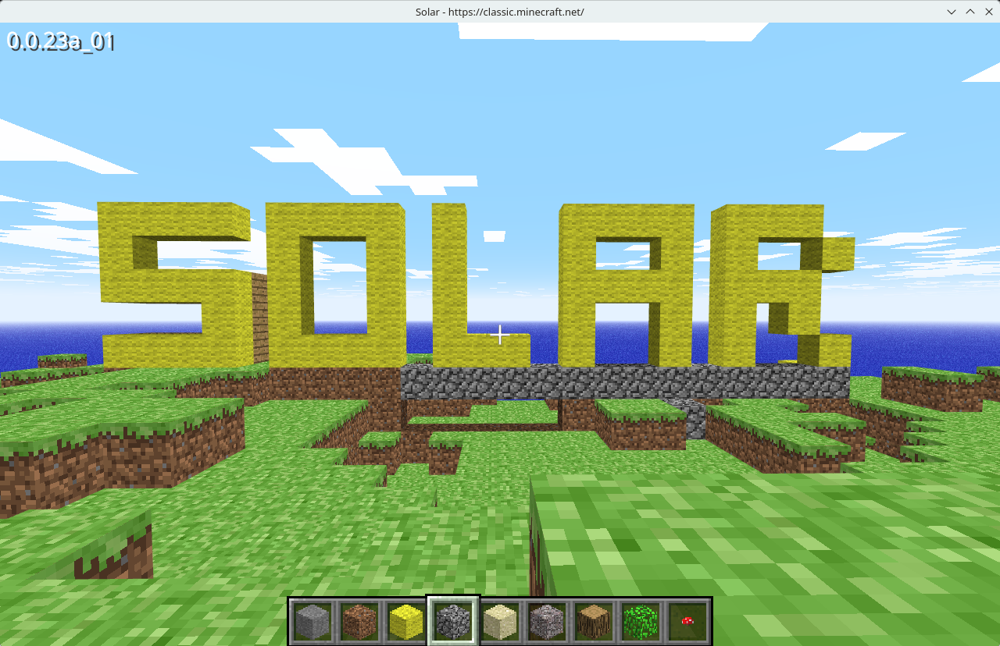
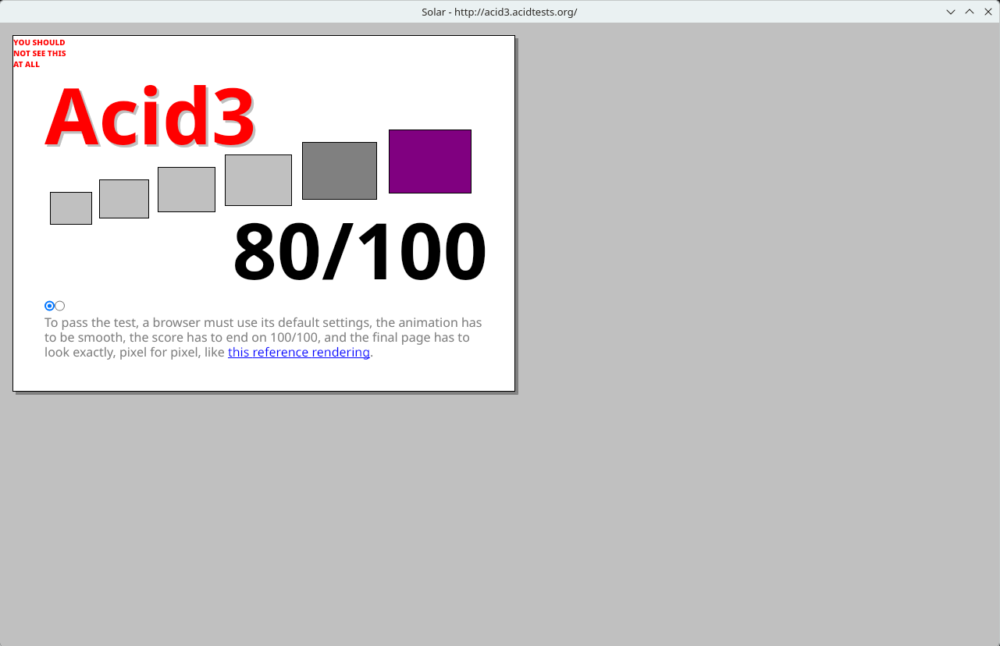
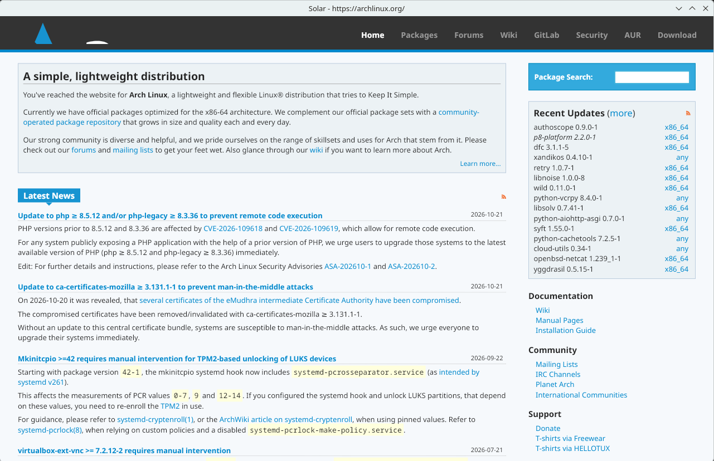
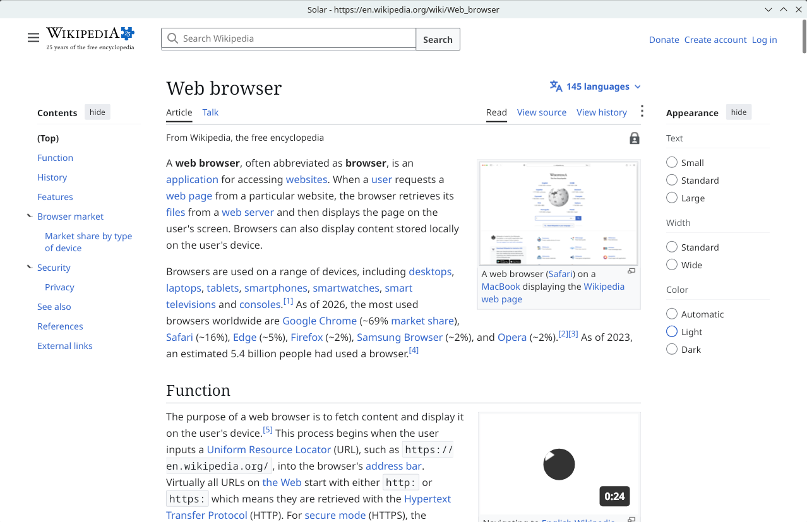
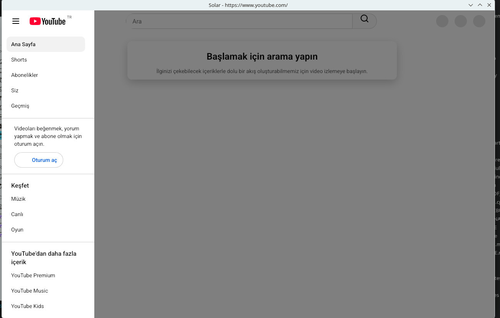

development will be slow due to my school life

currently solar is way better than what i planned

overall; performance is bad, it is not efficient because we haven't made major optimizations yet, first compatibility.

some examples from major websites;

(okay, performance is bad) youtube -> you can watch videos, listen songs, search for your favorite channel but it will take a while to load (10 secs to 30 secs) also after nearly a minute BotGuard stops the video, still working on it.

(nearly perfect) duckduckgo -> ai, noai, html versions works good, except some layout problems it is nearly perfect

(perfect) wikipedia -> just works, i see no problem

(nearly perfect) github -> rather than slight performance issues, you can surf on repos, star, fork etc.

(loads) google maps -> you can zoom in and out to the map and go around the world, location and bunch of other apis are missing, you can just see the 2d view of the world. (streetview etc. not tested, ui doesn't fully load)

(okay) games -> games like classic minecraft, wasm doom, neal.fun, krillion and travle works, there are some minor issues but mostly doesn't prevent playing (puffer party on krillion doesn't work because verification of cloudflare stucks but pages with cloudflare loads) (there can be performance issues on 3d games)

plans for solar;

first version with broad web support:  february 2027

## Screenshots

## Note

If you get errors while trying to build, especially on the network side, that is expected for now: the project relies on the system's packages at the moment. This will be sorted out once the project settles.