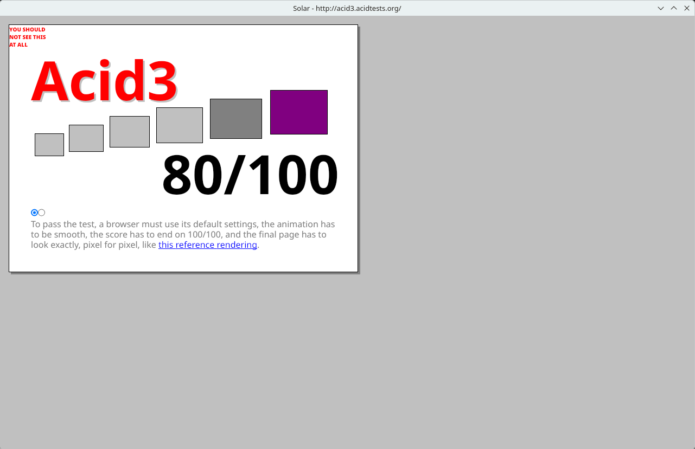
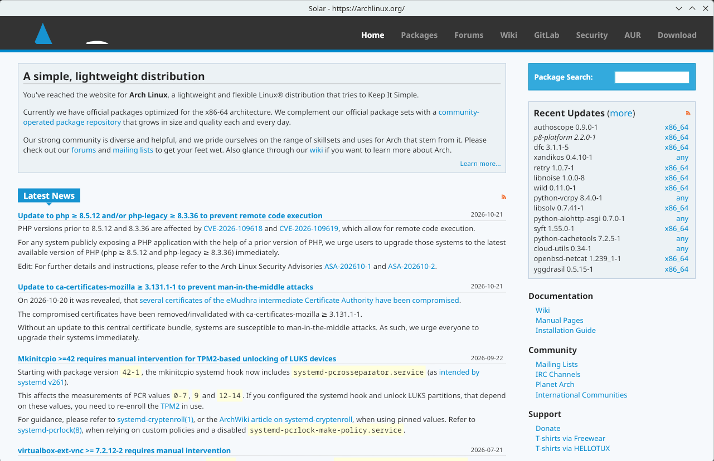
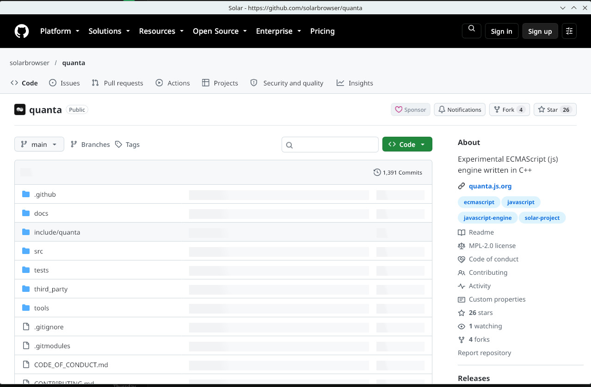
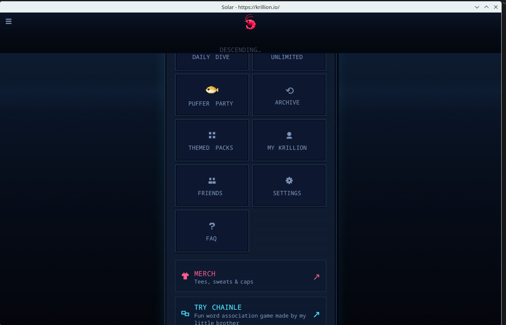
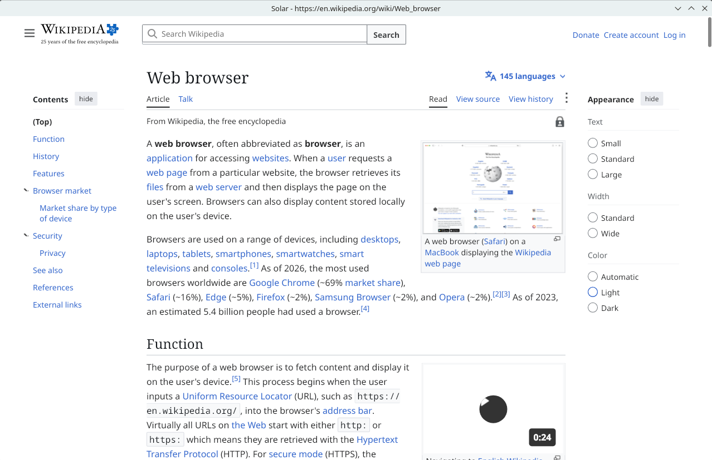
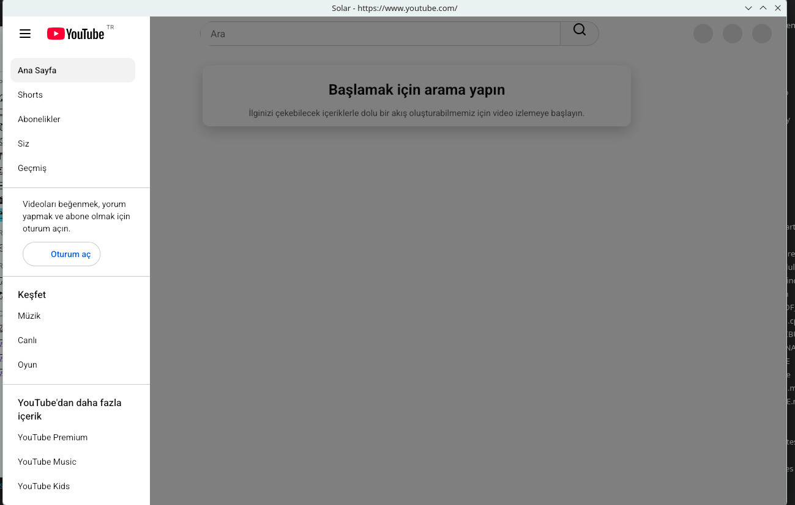

development will be slow due to my school life

plans for solar;

first version with broad web support:  february 2027

## Screenshots

## Note

If you get errors while trying to build, especially on the network side, that is expected for now: the project relies on the system's packages at the moment. This will be sorted out once the project settles.